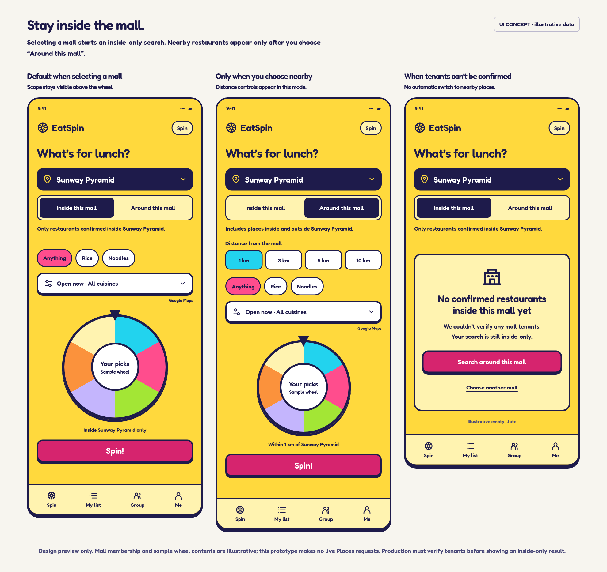

# Mall-only search UI concept

This is a standalone design prototype for review. It does not change EatSpin's
production UI or search behavior, make Places requests, or verify mall tenants.
The wheel contents are illustrative, and the three columns show alternative
states rather than a sequence of screens.

The working implementation for [issue #131](https://github.com/isaacncz/Eat-Spin/issues/131)
is now included alongside this prototype. See [destination search](../../destination-search.md)
for the actual behavior, verification rules, persistence, and known coverage limits.



## Preview

Open [index.html](index.html) in a browser, or serve this directory locally:

```sh
python3 -m http.server 4173 --directory docs/previews/mall-search
```

Then visit <http://localhost:4173>. The page stacks the three examples on phones.
The scope selector, radius choices, cuisine choices, and empty-state recovery
are interactive demonstrations. Other buttons explain their intended behavior;
they do not select a destination, fetch restaurants, or perform a real spin.

## Proposed behavior

- Selecting a confirmed mall defaults to **Inside this mall**. Place the scope
  selector directly below the destination so the restriction stays visible.
- In inside-only mode, hide distance controls and replace distance-based
  summaries with **Inside Sunway Pyramid only**. Apply the same restriction to
  text search, the wheel, and the selected result.
- **Around this mall** is an explicit user choice. Reveal the existing
  1 / 3 / 5 / 10 km controls and state that results can include places inside
  and outside the mall. The prototype illustrates 1 km; production should retain
  the existing radius preference.
- When tenants cannot be confirmed, keep inside-only mode and show an empty
  state. Offer **Search around this mall** and **Choose another mall**. Never
  automatically broaden the search, including after an error or empty result.
- Area, address, and current-location searches retain their existing behavior.

## Implementation boundary

This prototype predates the working feature. The app now identifies shopping malls
using provider place types and includes restaurants only when a containing place
ID matches the selected mall. Search identity, cancellation, caches, the wheel,
reloads, and empty/error states respect the scope. Inside-only searches cannot use
unrestricted nearby or bundled fallback results.

An official tenant directory may provide additional verified branch mappings in
a future change. Names, coordinates, and a mall name in an address are supporting
evidence, not sufficient proof on their own. Missing provider relationships are
excluded, so the current feature does not promise a complete mall directory.

## Preview validation

- Chromium layout checked at 360 px, 390 px, and 1320 px with no page overflow.
- Scope changes reveal/hide distance controls.
- Changing the radius updates the nearby summary.
- The empty-state nearby action explicitly switches the scope.
- No browser script errors during these checks.

These checks validate the prototype only. The working implementation has separate
mocked provider and browser coverage in `tests/mall-search.spec.ts` and
`tests/destination-search.spec.ts`.

## Assets

`fredoka.woff2` is Fredoka Latin 600 from `@fontsource/fredoka` 5.2.5, used to
preserve the existing EatSpin typography without external font requests. Its
SIL Open Font License is included in [FONT-LICENSE.txt](FONT-LICENSE.txt).
